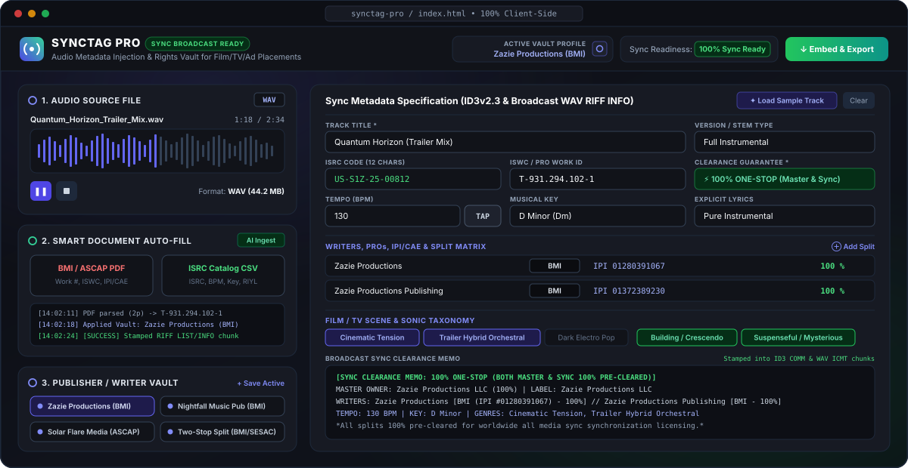
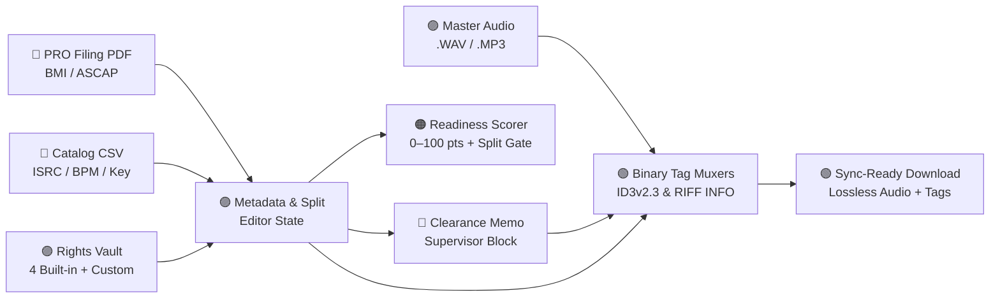
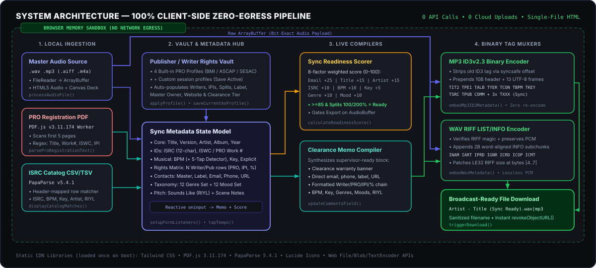
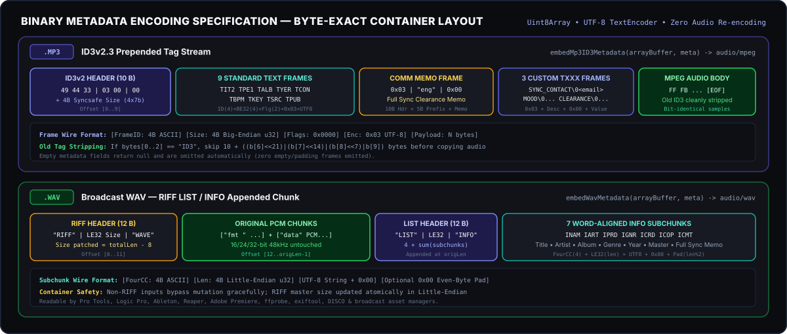
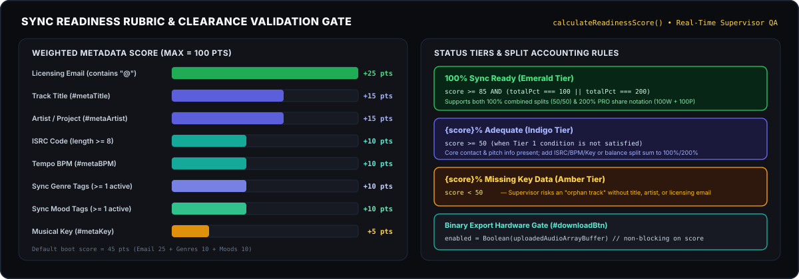

<div align="center">

# 🎙️ SYNCTAG PRO

### *Broadcast-Ready Audio Metadata Injection Engine & Publisher / Writer Rights Vault*

**Stamp lossless ID3v2.3 and Broadcast WAV `RIFF LIST/INFO` sync-clearance metadata, PRO/IPI splits, ISRCs, and music-supervisor memos directly inside master audio files — 100% in your browser with zero uploads.**

[](https://github.com/zazieproductions/SyncTag-Pro/actions/workflows/ci.yml)
[](docs/BINARY_FORMAT_SPEC.md#2-mp3-container-specification-embedmp3id3metadata)
[](docs/BINARY_FORMAT_SPEC.md#3-wav-container-specification-embedwavmetadata)
[](docs/SYNC_WORKFLOW_GUIDE.md#3-document-ingestion-schemas)
[](#-security--privacy)
[](index.html)
[](https://horror.zazieproductions.com)
[](LICENSE)

<br/>



**▲ SyncTag Pro Studio Workspace** — 3-panel ingestion & Rights Vault column · 13-frame ID3v2.3 & 7-chunk WAV binary tagger · live 100-point Sync Readiness scorer · auto-compiled Music Supervisor Clearance Memo

[**🚀 Quick Start**](#-quick-start--usage-instructions) · [**🏗️ Architecture**](#-system-architecture) · [**🎛️ Controls**](#-controls-reference) · [**🗄️ Presets & Taxonomies**](#-vault-presets--sync-taxonomies) · [**🔒 Security**](#-security--privacy) · [**🧪 Testing**](#-testing--verification) · [**📚 Docs Index**](#-technical-documentation--repository-layout)

</div>

---

> ### 🎨 Color-Code Legend Used Throughout This Repository
>
> | Swatch | Token | Hex | Domain Meaning in Docs & UI |
> |:---:|---|---|---|
> | 🟣 | **Studio Indigo** | `#6366F1` | Core engine, audio deck, Rights Vault profiles, Sync Genre tags & `Adequate` tier |
> | 🟢 | **Sync Emerald** | `#22C55E` | Binary export, One-Stop warranty, ISRC, Sync Mood tags & `100% Sync Ready` tier |
> | 🔵 | **Ingest Teal** | `#14B8A6` | Smart document ingestion (CSV/TSV), container specs & Clearance Memo compiler |
> | 🟠 | **QA Amber** | `#F59E0B` | Sync Readiness validation gates, `Missing Key Data` tier & operational advisories |
> | 🔴 | **PRO Rose** | `#F87171` | BMI/ASCAP PDF parser, destructive actions & security/threat-model boundaries |
> | ⚪ | **Studio Slate** | `#64748B` | Static chassis (`#0B0C10`–`#1E222D`), deployment infrastructure, CI & licensing |

---

## 📑 Table of Contents

| # | Color | Section | What You'll Find |
|:---:|:---:|---|---|
| **01** | 🟢 | [At a Glance](#-at-a-glance) | Problem solved, capability summary & core subsystem specs |
| **02** | 🟣 | [Quick Start & Usage Instructions](#-quick-start--usage-instructions) | 10-second launch, 5-step sync tagging playbook & CLI inspection |
| **03** | 🔵 | [System Architecture](#-system-architecture) | Zero-egress module map, sequence flow, binary layouts & frame/chunk tables |
| **04** | 🟣 | [Controls Reference](#-controls-reference) | Complete reference for every button, dropzone, input, select & modal |
| **05** | 🟢 | [Vault Presets & Sync Taxonomies](#-vault-presets--sync-taxonomies) | All 4 Vault profiles, sample cue, stem/clearance/key options, 24 tags & readiness rubric |
| **06** | 🟠 | [Performance Engineering](#-performance-engineering) | Zero-reencode `O(n)` muxing, memory profile, worker offloading & large-WAV limits |
| **07** | 🟣 | [Accessibility (a11y)](#-accessibility-a11y) | Measured WCAG 2.1 AA/AAA contrast ratios, keyboard semantics & hardening roadmap |
| **08** | 🔴 | [Security & Privacy](#-security--privacy) | Zero-egress memory sandbox, CDN audit, DOM surface review & production CSP |
| **09** | ⚪ | [Deployment](#-deployment) | GitHub Pages CI/CD, Cloudflare/Netlify/Vercel, studio LAN & air-gapped offline rig |
| **10** | 🟢 | [Testing & Verification](#-testing--verification) | Zero-dependency `node:test` binary test suite, CLI recipes & supervisor QA checklist |
| **11** | 🔵 | [Technical Documentation & Repository Layout](#-technical-documentation--repository-layout) | Deep-dive specs in `docs/`, GitHub scaffolding tree & roadmap |
| **12** | ⚪ | [Contributing & Licensing](#-contributing--licensing) | Contribution standards, MIT software license & Zazie Productions LLC rights notice |

---

## ⚡ At a Glance

Built for **Zazie Productions LLC** and working film, television, trailer, game, and advertising composers, **SyncTag Pro** eliminates "orphan tracks" — pitched audio files that lose clearance eligibility when separated from their pitch email or DISCO playlist. Every master exported through SyncTag Pro carries embedded legal contact details, one-stop warranty language, writer/publisher PRO affiliations, IPI/CAE identifiers, percentage splits, ISRC codes, tempo/key data, and scene-search keywords directly inside the binary audio container.

| Color | Subsystem | Specification |
|:---:|---|---|
| 🟣 | **Delivery Footprint** | Single self-contained `index.html` (~88 KB) · zero build step · zero server backend |
| 🟢 | **MP3 Binary Engine** | Native `Uint8Array` **ID3v2.3** muxer · strips stale ID3 headers · injects up to **13 UTF-8 frames** (`TIT2`..`TPUB`, `COMM`, `3× TXXX`) · bit-exact MPEG passthrough |
| 🔵 | **WAV Binary Engine** | Native `Uint8Array` **RIFF `LIST`/`INFO`** muxer · appends **7 word-aligned subchunks** (`INAM`, `IART`, `IPRD`, `IGNR`, `ICRD`, `ICOP`, `ICMT`) · patches LE32 header size · lossless PCM |
| 🔴 | **PRO PDF Auto-Fill** | Client-side **PDF.js v3.11.174** worker scans pages 1–5 of BMI/ASCAP work registrations · extracts Title, Work #, `ISWC`, and deduplicated 9–11 digit `IPI/CAE` IDs |
| 🔵 | **Catalog CSV Matcher** | Client-side **PapaParse v5.4.1** spreadsheet ingestion · fuzzy column-alias matching for Title, `ISRC`, BPM, Key, Artist & Sounds Like (`RIYL`) |
| 🟣 | **Rights Vault** | **4 pre-loaded entity profiles** (including *Zazie Productions (BMI)*) + unlimited custom session profiles with 1-click Writer/PRO/IPI/Label/Website recall |
| 🟠 | **Readiness Validator** | Real-time **100-point weighted scorer** + dual-convention split check (`100%` combined or `200%` BMI writer+publisher share) across 3 color-coded status tiers |
| 🟢 | **Privacy Guarantee** | **0 outbound API requests** · `fetch` / `XHR` / `WebSocket` / analytics completely absent · unreleased client masters never leave browser RAM |



---

## 🚀 Quick Start & Usage Instructions

### Prerequisites

- Any modern evergreen browser (**Chrome / Edge 110+**, **Firefox 115+**, or **Safari 16.4+**)
- Internet access on initial page load for the 4 static CDN libraries *(or vendor them locally for an [offline scoring rig](docs/DEPLOYMENT.md#5-air-gapped--offline-scoring-rig-deployment))*
- *(Optional, for local HTTP serving & running tests)* **Python 3** and **Node.js ≥ 20** — **no `npm install` required**

### 1. Launch Locally (10 Seconds)

```bash
# Clone the repository
git clone https://github.com/zazieproductions/SyncTag-Pro.git
cd SyncTag-Pro

# Option A — Recommended: serve over localhost (ensures strict-origin PDF.js worker support)
npm run serve
# -> Open http://127.0.0.1:8080

# Option B — Python 3 directly on any port
python3 -m http.server 8080 --bind 127.0.0.1

# Option C — Zero-CLI launch (macOS / Windows / Linux)
open index.html   # or double-click index.html in Finder / Explorer
```

### 2. Five-Step Sync Tagging Workflow

| Step | Badge | Action | Result |
|:---:|:---:|---|---|
| **1** |  | Drag & drop a broadcast `.wav` or 320 kbps `.mp3` into **1. Audio Source File** (or click to browse). | Audio loads into RAM, format badge updates, mini waveform player appears, Track Title auto-cleans from filename, and **Embed & Export** unlocks. |
| **2** |  | Click a preset pill in **3. Pre-Set Publisher / Writer Vault** (e.g., `Zazie Productions (BMI)`) or open the top-bar Vault modal. | Instantly fills Artist, Master Owner, Record Label, Website, Licensing Email, Phone, Clearance Guarantee, and all Writer/Publisher PRO + IPI + Split rows. |
| **3** |  | *(Optional)* Upload a **BMI / ASCAP PDF** registration or an **ISRC Catalog CSV** (try [`docs/samples/sample-isrc-catalog.csv`](docs/samples/sample-isrc-catalog.csv)) in **2. Smart Document Auto-Fill**. | Extracts Work #, ISWC, and IPIs from PDFs, or displays clickable track cards that auto-fill Title, ISRC, BPM, Key, Artist, and Sounds Like. |
| **4** |  | Set **Version / Stem Type**, enter or **TAP** Tempo (BPM), pick **Musical Key**, toggle **Genre** (🟣) & **Mood** (🟢) pills, and verify splits sum to `100%` or `200%`. | Live **Broadcast Sync Clearance Memo** compiles in `#metaComments` and the header pill flips to 🟢 **`100% Sync Ready`**. |
| **5** |  | Click **Embed & Export** in the top-right header bar (edit `#metaComments` manually beforehand if adding brief-specific notes). | Downloads `{Artist} - {Title} (Sync Ready).{wav\|mp3}` with embedded binary metadata and bit-identical audio frames. |

> 💡 **Fast Evaluation Without Registration Files:** Drop any `.mp3` or `.wav`, click **Load Sample Sync Track** in the editor header, select **Zazie Productions (BMI)** in the Vault, and click **Embed & Export**.

### 3. Verify Embedded Metadata

```bash
# Inspect exported MP3 (ID3v2.3) or WAV (RIFF LIST/INFO) in FFmpeg
ffprobe -hide_banner "Zazie Productions - Quantum Horizon (Trailer Mix) (Sync Ready).mp3"

# Inspect every frame including custom TXXX (SYNC_CONTACT, MOOD, CLEARANCE) in ExifTool
exiftool -G1 -a -s "Zazie Productions - Quantum Horizon (Trailer Mix) (Sync Ready).mp3"
```

---

## 🏗️ System Architecture

> 📖 Full engineering deep dives: [**`docs/ARCHITECTURE.md`**](docs/ARCHITECTURE.md) · [**`docs/BINARY_FORMAT_SPEC.md`**](docs/BINARY_FORMAT_SPEC.md)



### Runtime Module Breakdown

SyncTag Pro runs entirely inside a single HTML document (`index.html`, 1,582 lines: declarative Tailwind layout + 1,061-line ES2020+ runtime) partitioned into seven cohesive modules:

| Color | Module | Key Functions | Responsibility |
|:---:|---|---|---|
| ⚪ | **1. App Shell & Feedback** | `DOMContentLoaded`, `setupFormListeners()`, `logStatus()`, `showToast()` | Hydrates Lucide icons, wires reactive `oninput` handlers, streams timestamped `[HH:MM:SS]` ingestion logs, and drives toast alerts. |
| 🟣 | **2. Audio Source Deck** | `setupDropzone()`, `processAudioFile()`, `loadAudioIntoPlayer()`, `drawDummyWaveform()` | Handles drag/drop + picker uploads, reads raw `ArrayBuffer`, manages HTML5 `<audio>` transport, and renders the `<canvas>` playhead bar graph. |
| 🔴 | **3. PRO PDF Parser** | `handlePdfUpload()`, `parseProRegistrationText()` | Offloads PDF decoding to the PDF.js v3.11.174 Web Worker (first 5 pages) and extracts Work Title, Work #, `ISWC`, and unique `IPI/CAE` IDs via regex heuristics. |
| 🔵 | **4. CSV Catalog Matcher** | `handleCsvUpload()`, `displayCatalogMatches()` | Parses `.csv`/`.tsv`/`.txt` catalogs with PapaParse v5.4.1 (`header: true`) and renders up to 10 interactive one-click cue-matching cards. |
| 🟣 | **5. Publisher / Writer Vault** | `renderProfilePills()`, `applyProfile()`, `openProfileModal()`, `saveCurrentAsProfile()` | Manages preset and custom session catalog entities across both the sidebar pill bar and modal selector, syncing writers, PROs, IPIs, splits, label, website, and contacts. |
| 🟠 | **6. Live Memo & QA Engine** | `updateCommentsField()`, `calculateReadinessScore()`, `addWriterRow()`, `removeWriterRow()`, `tapTempo()` | Compiles the structured supervisor Clearance Memo on every keystroke, computes the 100-pt readiness badge, manages dynamic split rows, and calculates 5-tap BPM. |
| 🟢 | **7. Binary Tag Muxers** | `triggerDownload()`, `stringToBytes()`, `embedMp3ID3Metadata()`, `embedWavMetadata()` | Performs lossless byte-level `Uint8Array` injection of ID3v2.3 frames (MP3) or word-aligned RIFF `LIST`/`INFO` chunks (WAV) and triggers sanitized Blob download. |

### Binary Metadata Injection Specification



#### 🟣 MP3 Container — Emitted ID3v2.3 Frames (13 Frames)

Existing leading `ID3` headers are stripped cleanly via 28-bit syncsafe length decoding (`10 + ((b[6]<<21)|(b[7]<<14)|(b[8]<<7)|b[9])`) before prepending a fresh 10-byte header (`49 44 33 03 00 00` + syncsafe size) and UTF-8 (`0x03`) frames:

| # | Frame | Descriptor / Lang | Source Control | Default Fallback | Embedded Meaning |
|:---:|---|---|---|---|---|
| 1 | `TIT2` | — | `#metaTitle` | `Sync Track` | Track / cue title |
| 2 | `TPE1` | — | `#metaArtist` | `Unknown Artist` | Lead artist / composer / studio |
| 3 | `TALB` | — | `#metaAlbum` | `Sync Catalog` | Album, sync reel, or cue package |
| 4 | `TYER` | — | `#metaYear` | `2025` | Recording / release year |
| 5 | `TCON` | — | `selectedGenres` | `Soundtrack` | Active sync genres joined by ` / ` |
| 6 | `TBPM` | — | `#metaBPM` | *(omitted if blank)* | Tempo in beats per minute |
| 7 | `TKEY` | — | `#metaKey` | *(omitted if blank)* | Initial musical key (e.g., `D Minor`) |
| 8 | `TSRC` | — | `#metaISRC` | *(omitted if blank)* | 12-character ISRC recording identifier |
| 9 | `TPUB` | — | `#metaMasterOwner` | *(omitted if blank)* | Master owner / publishing entity |
| 10 | `COMM` | `lang="eng"` | `#metaComments` | *(omitted if blank)* | Full multi-line Broadcast Sync Clearance Memo |
| 11 | `TXXX` | `SYNC_CONTACT` | `#metaContactEmail` | *(omitted if blank)* | Direct sync clearance email |
| 12 | `TXXX` | `MOOD` | `selectedMoods` | *(omitted if blank)* | Active sync mood tags joined by `, ` |
| 13 | `TXXX` | `CLEARANCE` | `#metaClearance` | *(always selected)* | Pre-clearance / one-stop legal warranty tier |

#### 🟢 WAV Container — Emitted RIFF `LIST` / `INFO` Subchunks (7 Subchunks)

Uncompressed PCM audio (`fmt ` and `data` chunks) remains 100% untouched. A 16-bit word-aligned `LIST`/`INFO` chunk is appended at EOF and the master little-endian `RIFF` size at bytes `[4..7]` is updated to `newTotalLength - 8`:

| # | FourCC | RIFF Standard Field | Source Control | Null + Alignment | Embedded Meaning |
|:---:|---|---|---|---|---|
| 1 | `INAM` | Name | `#metaTitle` | UTF-8 + `0x00` + `len%2` pad | Track / cue title |
| 2 | `IART` | Artist | `#metaArtist` | UTF-8 + `0x00` + `len%2` pad | Performing artist / composer |
| 3 | `IPRD` | Product | `#metaAlbum` | UTF-8 + `0x00` + `len%2` pad | Album / sync reel title |
| 4 | `IGNR` | Genre | `selectedGenres` | UTF-8 + `0x00` + `len%2` pad | Sync genres separated by ` / ` |
| 5 | `ICRD` | Creation Date | `#metaYear` | UTF-8 + `0x00` + `len%2` pad | Release / copyright year |
| 6 | `ICOP` | Copyright | `#metaMasterOwner` | UTF-8 + `0x00` + `len%2` pad | Master recording owner |
| 7 | `ICMT` | Comments | `#metaComments` | UTF-8 + `0x00` + `len%2` pad | Full Broadcast Sync Clearance Memo (splits, IPIs, BPM, key, label, URL, contact, RIYL) |

> 🟠 **Format Boundary Notes:** (1) `#audioFileInput` accepts `.aiff` and `.m4a` for in-browser auditioning, while binary export targets `.wav` and `.mp3` containers — supply `.wav` or `.mp3` masters when exporting. (2) v1.x writes RIFF `LIST`/`INFO` chunks for WAV; dedicated 602-byte EBU Tech 3285 `bext` chunk injection is planned in v1.2 (see [`docs/BINARY_FORMAT_SPEC.md`](docs/BINARY_FORMAT_SPEC.md)).

---

## 🎛️ Controls Reference

### A. Top Navigation & Sync Health Bar

| Control | DOM ID / Handler | Type | Behavior |
|---|---|---|---|
| **Active Vault Profile Indicator** | `#activeProfileDisplay` | Readout (`md:`+) | Displays currently applied publishing/writer entity name (boot default: `Nightfall Music Pub (BMI)`). |
| **Vault Database Switcher** | `openProfileModal()` | Icon Button | Opens the modal drawer listing all preset and session-saved Rights Vault profiles. |
| **Sync Readiness Pill** | `#syncScoreBadge` | Live Status Badge | Color-coded real-time QA badge: 🟢 `100% Sync Ready`, 🟣 `{score}% Adequate`, or 🟠 `{score}% Missing Key Data`. |
| **Embed & Export** | `#downloadBtn` / `triggerDownload()` | Primary CTA | Disabled until audio is loaded; muxes binary ID3v2.3 or RIFF `LIST`/`INFO` tags and triggers sanitized browser download. |

### B. Left Column — Ingestion, Audio Deck & Vault Controls

| Panel | Control | DOM ID / Handler | Accepted / Constraint | Behavior |
|---|---|---|---|---|
| **1. Audio Source** | Audio Dropzone | `#audioDropzone` + `#audioFileInput` | `.mp3, .wav, .aiff, .m4a` | Supports drag-over highlight + file picker; loads raw `ArrayBuffer`, auto-populates empty `#metaTitle`, shows player deck. |
| **1. Audio Source** | Format Badges | `#audioFormatBadge`, `#detectedFormat` | Readout | Reflects uppercase file extension (e.g., `WAV`, `MP3`). |
| **1. Audio Source** | Play / Pause | `#playPauseBtn` | Button | Toggles HTML5 `<audio>` playback and swaps `play` / `pause` icon. |
| **1. Audio Source** | Stop | `#stopBtn` | Button | Pauses playback, resets `currentTime = 0`, and restores `play` icon. |
| **1. Audio Source** | Waveform & Timecode | `#waveformCanvas`, `#currentTrackMeta` | Canvas + Readout | Renders responsive harmonic bar graph with indigo (`#6366f1`) played progress and `m:ss / m:ss` counter. |
| **2. Smart Auto-Fill** | BMI / ASCAP PDF | `#pdfFileInput` / `handlePdfUpload()` | `.pdf` (pages 1–5) | Extracts Work Title → `#metaTitle`, `ISWC` + `#WorkID` → `#metaISWC`, and unique 9–11 digit `IPI`s → `.writer-row` IPI fields. |
| **2. Smart Auto-Fill** | ISRC Catalog CSV | `#csvFileInput` / `handleCsvUpload()` | `.csv, .tsv, .txt` | Parses header-keyed rows and surfaces up to 10 one-click **Match** cards in `#catalogMatches`. |
| **2. Smart Auto-Fill** | Ingestion Console | `#parseStatusBox` | Monospace Log | Auto-scrolling activity terminal logging loads, regex extractions, profile switches, exports, and errors. |
| **3. Rights Vault** | Save Active | `saveCurrentAsProfile()` | Prompt → Button | Snapshots active Artist, Master Owner, Label, Website, Email, Phone, Clearance, and all Split rows into a new Vault pill. |
| **3. Rights Vault** | Profile Pills & Modal | `#profilePillsContainer`, `#profileModal` | Quick Buttons / Modal | One-click entity switcher populating all rights, contact, label, portfolio, and writer/publisher rows. |

#### 🔵 CSV Catalog Auto-Matcher Column Aliases

| Target Editor Field | Accepted Spreadsheet Column Headers (Fallback Order) |
|---|---|
| Track Title (`#metaTitle`) | `Title` → `Track Title` → `Song` → `Track` → `Name` → *(First column value)* |
| ISRC Code (`#metaISRC`) | `ISRC` → `ISRC Code` → `isrc` |
| Tempo (`#metaBPM`) | `BPM` → `Tempo` |
| Musical Key (`#metaKey`) | `Key` → `Tone` *(exact option match, e.g., `D Minor`)* |
| Artist (`#metaArtist`) | `Artist` |
| Sounds Like (`#metaSoundsLike`) | `Sounds Like` |

### C. Right Column — Sync Metadata Specification Editor

| Group | Control Label | DOM ID | Input Type | Default Value | Readiness Weight & Export Target |
|---|---|---|---|---|---|
| **Toolbar** | Load Sample Sync Track | `fillSampleSyncData()` | Button | — | Populates demo trailer cue (*Quantum Horizon*) + recalculates memo/score |
| **Toolbar** | Clear | `resetMetadataForm()` | Button | — | Clears Title, ISRC, ISWC, BPM & Sounds Like (retains Vault contact/splits) |
| **Core** | Track Title `*` | `#metaTitle` | `text` | `""` | **+15 pts** · MP3 `TIT2`, WAV `INAM`, filename |
| **Core** | Version / Stem Type | `#metaVersion` | `select` (7) | `Instrumental` | Delivery stem classification selector |
| **Core** | Artist / Project `*` | `#metaArtist` | `text` | `""` | **+15 pts** · MP3 `TPE1`, WAV `IART`, Vault, filename |
| **Core** | Album / Sync Reel | `#metaAlbum` | `text` | `""` | MP3 `TALB`, WAV `IPRD` |
| **Core** | Year | `#metaYear` | `text` | `2025` | MP3 `TYER`, WAV `ICRD` |
| **IDs** | ISRC Code | `#metaISRC` | `text` (`max=15`) | `""` | **+10 pts** (when `length ≥ 8`) · MP3 `TSRC` |
| **IDs** | ISWC / PRO Work ID | `#metaISWC` | `text` | `""` | Composition & PRO registration reference (PDF target) |
| **Rights** | Clearance Guarantee `*` | `#metaClearance` | `select` (4) | `100% ONE-STOP...` | MP3 `TXXX:CLEARANCE`, Memo header, Vault |
| **Musical** | Tempo (BPM) | `#metaBPM` | `number` | `""` | **+10 pts** · MP3 `TBPM`, Memo `TEMPO:` |
| **Musical** | TAP Tempo | `#tapTempoBtn` | Button | 5-tap window | Computes `round(60000 / avgInterval)` for `(40, 240)` BPM |
| **Musical** | Musical Key | `#metaKey` | `select` (11) | `""` | **+5 pts** · MP3 `TKEY`, Memo `KEY:` |
| **Musical** | Explicit Lyrics | `#metaExplicit` | `select` (3) | `Clean / None` | Broadcast FCC / network content advisory |
| **Splits** | Add Split | `addWriterRow()` | Button | 2 initial rows | Appends new Writer/Publisher + PRO + IPI + Split `%` row |
| **Splits** | Writer / Pub Legal Name | `.writer-row input[0]` | `text` | `Marcus Vance` / `Nightfall...` | Memo `WRITERS / PUBLISHERS:`, Vault |
| **Splits** | PRO Affiliation | `.writer-row select` | `select` (5–6) | `BMI` | Memo `[PRO ...]`, Vault |
| **Splits** | IPI / CAE # | `.writer-row input[2]` | `text` | `00849204918` / `00389102451` | Memo `(IPI #...)`, PDF target, Vault |
| **Splits** | Split Percentage | `.split-percent` | `number` (`1–100`) | `50` / `50` | **Gate:** sum must equal `100` or `200` for `100% Sync Ready` |
| **Splits** | Remove Split Row | `removeWriterRow()` | Icon Button | Min 1 row | Deletes row (blocks removal of final remaining row with toast) |
| **Contact** | Master Owner | `#metaMasterOwner` | `text` | `Nightfall Records LLC` | MP3 `TPUB`, WAV `ICOP`, Memo `MASTER OWNER:`, Vault |
| **Contact** | Licensing Direct Email `*` | `#metaContactEmail` | `email` | `sync@nightfallmusic.com` | **+25 pts** (must contain `@`) · MP3 `TXXX:SYNC_CONTACT`, Memo |
| **Contact** | Licensing Phone | `#metaContactPhone` | `text` | `+1 (310) 555-0192` | Memo `DIRECT CONTACT:`, Vault |
| **Contact** | Record Label | `#metaRecordLabel` | `text` | `""` | Conditional Memo `RECORD LABEL:` line, Vault |
| **Contact** | Website / Portfolio | `#metaWebsite` | `url` | `""` | Conditional Memo `WEBSITE / PORTFOLIO:` line, Vault |
| **Sonic** | Sync Genre Pills | `#genreTagCloud` | 12 Toggle Pills | 2 active | **+10 pts** (`≥ 1`) · MP3 `TCON`, WAV `IGNR`, Memo `GENRES:` |
| **Sonic** | Sync Mood & Vibe Pills | `#moodTagCloud` | 12 Toggle Pills | 2 active | **+10 pts** (`≥ 1`) · MP3 `TXXX:MOOD`, Memo `MOODS:` |
| **Sonic** | Sounds Like / RIYL | `#metaSoundsLike` | `text` | `Hans Zimmer, Stranger Things, Tycho` | Memo `RIYL / SOUNDS LIKE:`, CSV target |
| **Sonic** | Ideal TV / Film Placements | `#metaPlacementNotes` | `text` | `Crime Drama, High-Speed Chase...` | Editorial scene targeting worksheet field |
| **Memo** | Sync Clearance Memo | `#metaComments` | `textarea` (3 rows) | Auto-compiled | MP3 `COMM` (`eng`) & WAV `ICMT` (editable prior to export) |

---

## 🗄️ Vault Presets & Sync Taxonomies

### 1. 🟣 Built-In Publisher / Writer Vault Profiles (`syncProfiles`)

| Profile Name (`id`) | Artist | Master Owner / Label | Writers & Publishers (PRO · IPI · Split) | Direct Contact & Portfolio | Clearance Tier |
|---|---|---|---|---|---|
| **Zazie Productions (BMI)**<br/>`profile_zazie` | Zazie Productions | **Master:** Zazie Productions LLC (100%)<br/>**Label:** Zazie Productions LLC | • Zazie Productions (`BMI` · IPI `01280391067` · **100%**)<br/>• Zazie Productions Publishing (`BMI` · IPI `01372389230` · **100%**) | `zaziediya@gmail.com`<br/>`+1 (864) 430-0606`<br/>[horror.zazieproductions.com](https://horror.zazieproductions.com) | 🟢 100% ONE-STOP (Master & Sync) |
| **Nightfall Music Pub (BMI)**<br/>`profile_1` *(demo)* | Marcus Vance | **Master:** Nightfall Records LLC (100%) | • Marcus Vance (`BMI` · IPI `00849204918` · **50%**)<br/>• Nightfall Music Publishing (`BMI` · IPI `00389102451` · **50%**) | `licensing@nightfallmusic.com`<br/>`+1 (310) 892-4911` | 🟢 100% ONE-STOP (Master & Sync) |
| **Solar Flare Media (ASCAP)**<br/>`profile_2` *(demo)* | Sarah Jenkins | **Master:** Solar Flare Group (100% Master) | • Sarah Jenkins (`ASCAP` · IPI `00592817293` · **50%**)<br/>• Solar Flare Publishing (`ASCAP` · IPI `00918237462` · **50%**) | `sync@solarflaremedia.tv`<br/>`+1 (212) 402-9900` | 🟢 100% ONE-STOP (Master & Sync) |
| **Two-Stop Split (Writer BMI / Pub SESAC)**<br/>`profile_3` *(demo)* | Echo & Iron | **Master:** Echo & Iron LLC | • Tyler Reed (`BMI` · IPI `00712398412` · **50%**)<br/>• Velocity Beats Pub (`SESAC` · IPI `00192837411` · **50%**) | `clearance@echoironmusic.com`<br/>`+1 (615) 320-1122` | 🔵 200% Pre-Cleared (Co-Publishing) |

### 2. 🔵 Sample Sync Track Preset (`fillSampleSyncData()`)

| Field | Pre-Filled Value | Field | Pre-Filled Value |
|---|---|---|---|
| **Track Title** | `Quantum Horizon (Trailer Mix)` | **ISWC** | `T-931.294.102-1` |
| **Artist / Project** | `Atlas Silver & Nightfall` | **Tempo (BPM)** | `130` |
| **Album / Sync Reel** | `Cinematic Impact Reels Vol. 1` | **Musical Key** | `D Minor` |
| **Year** | `2025` | **Sounds Like (RIYL)** | `Hans Zimmer, Junkie XL, Interstellar` |
| **ISRC Code** | `US-S1Z-25-00812` | **Placement Notes** | `Sci-fi blockbuster climax, Epic video game trailer` |

### 3. 🟢 Selector Presets (Versions, Clearance Tiers, Keys, Explicit & PROs)

| Selector | Available Preset Options |
|---|---|
| **Version / Stem Type** (7) | `Full Instrumental` *(default, value: `Instrumental`)* · `Full Vocal Master` (`Main Vocal`) · `TV Mix (Backing Vocals Only)` (`TV Mix / No Lead`) · `Underscore / Light` · `60s Commercial Cutdown` (`60s Cutdown`) · `30s Promo Cutdown` (`30s Promo`) · `Full Stems Available` (`Stems Available`) |
| **Clearance Guarantee** (4) | 🟢 `100% ONE-STOP (Both Master & Sync 100% Pre-cleared)` *(default)* · 🔵 `200% Pre-Cleared (Standard Indie Co-Publishing)` · 🟠 `Master Only Pre-Cleared (Pub Requires Clearance)` · ⚪ `Direct License / Buyout` |
| **Musical Key** (11) | `A Minor` · `C Major` · `D Minor` · `E Minor` · `F Major` · `G Major` · `F# Minor` · `Bb Major` · `B Minor` · `Ab Major` · `Eb Major` |
| **Explicit Lyrics** (3) | `Clean / Safe for Broadcast` (`Clean / None`, *default*) · `Explicit (Contains Profanity)` (`Explicit Lyrics`) · `Pure Instrumental` (`Instrumental (No Vocals)`) |
| **PRO Affiliations** (6) | `BMI` *(default)* · `ASCAP` · `SESAC` · `PRS` (PRS for Music) · `SOCAN` · `GEMA` *(initial writer row)* |

### 4. 🟣 Sync Genre & 🟢 Sync Mood Tag Clouds (24 Supervisor Keywords)

| # | 🟣 Preset Sync Genre (`PRESET_GENRES`) | Default | # | 🟢 Preset Sync Mood & Vibe (`PRESET_MOODS`) | Default |
|:---:|---|:---:|:---:|---|:---:|
| 1 | `Cinematic Tension` | **Active** | 1 | `Building / Crescendo` | **Active** |
| 2 | `Trailer Hybrid Orchestral` | **Active** | 2 | `Dark / Ominous` | — |
| 3 | `Indie Rock/Pop` | — | 3 | `Triumphant / Heroic` | — |
| 4 | `Neo-Classical Ambient` | — | 4 | `Heartfelt / Intimate` | — |
| 5 | `Synthwave / 80s Retro` | — | 5 | `Urgent / Driving` | — |
| 6 | `Dark Electro Pop` | — | 6 | `Hopeful / Uplifting` | — |
| 7 | `Acoustic Folk / Singer-Songwriter` | — | 7 | `Suspenseful / Mysterious` | **Active** |
| 8 | `Action Promo / Sports` | — | 8 | `Gritty / Edgy` | — |
| 9 | `Hip-Hop Beats` | — | 9 | `Melancholic / Nostalgic` | — |
| 10 | `Dramedy / Quirky` | — | 10 | `Playful / Lighthearted` | — |
| 11 | `Epic Orchestral` | — | 11 | `Aggressive / Badass` | — |
| 12 | `Atmospheric Lo-Fi` | — | 12 | `Reflective / Peaceful` | — |

### 5. 🟠 Live Sync Readiness Score Rubric (`calculateReadinessScore()`)



| Tier Badge | Trigger Formula | Operational Meaning |
|---|---|---|
| 🟢 **`100% Sync Ready`** | `score ≥ 85` **AND** `(totalSplit === 100 \|\| totalSplit === 200)` | Meets full broadcast & music-supervisor clearance standards (both 50/50 combined & 100W/100P BMI conventions supported). |
| 🟣 **`{score}% Adequate`** | `score ≥ 50` *(or `score ≥ 85` with unbalanced split sum)* | Core contact metadata present; verify ISRC/BPM/Key or reconcile split percentages to `100%` / `200%`. |
| 🟠 **`{score}% Missing Key Data`** | `score < 50` | High orphan-track risk — add Title (`+15`), Artist (`+15`), and valid Licensing Email (`+25`) before pitching. |

---

## ⚙️ Performance Engineering

| Dimension | Measured Behavior | Engineering Mechanism |
|---|---|---|
| **Application Payload** | **~88 KB** raw HTML/JS (~19 KB gzipped) | Zero framework runtime; single static document served from edge cache in `< 30 ms`. |
| **Binary Tag Injection** | **O(n) linear copy · `< 15 ms`** for a 10 MB MP3; **`< 60 ms`** for a 50 MB 24-bit/48 kHz WAV | Direct `Uint8Array.prototype.set()` byte splicing — zero Web Audio decoding, FFT, or MP3/PCM re-encoding. |
| **Memory Profile** | Peak RAM ≈ **`2× file size`** during export (`source ArrayBuffer` + `output Uint8Array`) | Comfortably tags 3–8 minute stereo 24-bit/48 kHz WAV cues (30–150 MB) on standard 8–16 GB studio laptops; exported Blob URLs are released immediately via `URL.revokeObjectURL()`. |
| **PDF Ingestion** | Non-blocking off-main-thread decode, bounded to **`min(numPages, 5)`** | Uses PDF.js dedicated Web Worker (`pdf.worker.min.js`) and caps page traversal so multi-dozen-page Schedule A filings never stall UI interaction. |
| **CSV Catalog Parsing** | Instantaneous up to thousands of rows; DOM capped to **10 match cards** | `displayCatalogMatches()` slices rendered DOM nodes (`rows.slice(0, 10)`) to avoid layout thrashing on large library catalogs. |
| **Waveform Playback** | Zero-allocation procedural `<canvas>` draw on `ontimeupdate` (~4 Hz) | Draws deterministic harmonic bars directly to 2D canvas without decoding multi-megabyte WAVs into 32-bit float `AudioBuffer`s. |

> 🟠 **Large Stem Master Tip:** Standard 32-bit RIFF containers support files up to **4 GiB**, while browser single-`ArrayBuffer` limits typically sit at **1–2 GiB** per tab. For long-form film reels exceeding ~400 MB, tag per-cue stems individually (zero-copy `Blob([header, file.slice(8), listChunk])` streaming is tracked on the roadmap).

---

## ♿ Accessibility (a11y)

> 📖 Full audit & remediation plan: [**`docs/ACCESSIBILITY_AND_SECURITY.md`**](docs/ACCESSIBILITY_AND_SECURITY.md#part-i--accessibility-wcag-21-aa)

SyncTag Pro's dark-studio color system is calibrated for low-glare control rooms while maintaining strong foreground/background luminance contrast:

| Surface / Role | Foreground × Background | Contrast Ratio | WCAG 2.1 Rating |
|---|---|:---:|:---:|
| Primary text & field inputs | `#F1F5F9` on `#111319` | **17.4 : 1** | 🟢 **AAA** |
| Form & section labels | `#CBD5E1` on `#171A23` | **11.5 : 1** | 🟢 **AAA** |
| Emerald ISRC & Ready state | `#4ADE80` on `#111319` | **10.6 : 1** | 🟢 **AAA** |
| Amber warning readiness badge | `#FBBF24` on `#171A23` | **10.3 : 1** | 🟢 **AAA** |
| Indigo IPI & Vault readouts | `#A5B4FC` on `#111319` | **9.3 : 1** | 🟢 **AAA** |
| Secondary helper descriptions | `#94A3B8` on `#171A23` | **6.1 : 1** | 🟢 **AA** |

### Built-In Ergonomics & Tracked WCAG 2.1 AA Improvements

- **Implemented Today:** `<html lang="en">` declaration, unrestricted viewport zoom scaling, single-column responsive reflow below `1024px`/`768px`, native `<button>`/`<input>`/`<select>`/`<textarea>`/`<label>` controls, text+percentage redundancy on all color-coded badges (color-blind safe), and zero strobing or auto-playing motion.
- **Tracked Accessibility Roadmap:** Explicit `<label for="...">` associations on all metadata inputs, `aria-label` attributes on icon-only transport/row-delete buttons, `aria-pressed` state on genre/mood toggle pills, keyboard `Enter`/`Space` activation on `#audioDropzone`, `role="dialog"` + focus trap + `Escape` dismissal on `#profileModal`, `aria-live="polite"` announcements on `#toastNotification` and `#syncScoreBadge`, and `@media (prefers-reduced-motion: reduce)` guards.

---

## 🔒 Security & Privacy

> 📖 Full threat model & CSP configuration: [**`docs/ACCESSIBILITY_AND_SECURITY.md`**](docs/ACCESSIBILITY_AND_SECURITY.md#part-ii--security--privacy-architecture) · Vulnerability disclosure: [**`SECURITY.md`**](SECURITY.md)

- 🟢 **100% Local Zero-Egress Processing:** Audio masters, BMI/ASCAP PDFs, and ISRC spreadsheets are read exclusively via browser `FileReader` and `File.prototype.arrayBuffer()`. `index.html` contains **zero** `fetch()`, `XMLHttpRequest`, `WebSocket`, or `navigator.sendBeacon()` calls (continuously enforced by automated CI tests).
- 🟢 **Zero Telemetry & Zero Persistent Disk Footprint:** No cookies, no analytics trackers, no fingerprinting, and no `localStorage`/`IndexedDB` writes. Session-saved Vault profiles disappear cleanly when the tab closes.
- 🟢 **Non-Destructive File Handling:** Source files on disk are never mutated in place; SyncTag Pro emits a new `(Sync Ready)` copy with reserved path characters (`/\?%*:|"<>`) sanitized to `_`.
- 🟠 **Third-Party CDN Posture:** Boot loads Tailwind Play CDN, pinned `pdf.js@3.11.174`, pinned `PapaParse@5.4.1`, and `lucide@latest` over HTTPS. For high-security or NDA-bound studio environments, pin all scripts with Subresource Integrity (`integrity="sha384-..."`) or self-host local vendor copies alongside a strict `connect-src 'none'; form-action 'none'` Content-Security-Policy (provided in [`docs/ACCESSIBILITY_AND_SECURITY.md`](docs/ACCESSIBILITY_AND_SECURITY.md#3-recommended-production-http-security-headers)).
- 🟠 **Trusted Catalog Inputs & Fork Hygiene:** Import CSV spreadsheets only from trusted sources (studio catalogs, distributors, DISCO). When forking this repository publicly, replace the built-in `syncProfiles` entries with your business sync-licensing contact inbox rather than personal details.
- 🔴 **Responsible Disclosure:** Report security vulnerabilities privately via [GitHub Security Advisories](https://github.com/zazieproductions/SyncTag-Pro/security/advisories/new) or the instructions in [`SECURITY.md`](SECURITY.md).

---

## 🚢 Deployment

> 📖 Full platform & Nginx/offline instructions: [**`docs/DEPLOYMENT.md`**](docs/DEPLOYMENT.md)

SyncTag Pro requires **no build command, no server runtime, and no secrets**. Deploy `index.html` anywhere static files are served:

| Target | Build Command | Output Dir | Setup |
|---|---|---|---|
| **GitHub Pages** *(included)* | *(automated)* | `_site/` | Enable **Settings → Pages → Source: GitHub Actions** — [`.github/workflows/pages.yml`](.github/workflows/pages.yml) runs `npm run verify` and deploys `index.html` + `.nojekyll` automatically. |
| **Cloudflare Pages** | *(none)* | `/` | Connect repo, leave build command empty, optionally attach `connect-src 'none'` CSP header. |
| **Netlify / Vercel** | *(none)* | `.` | Framework preset: **Other**; instant edge deploy with automatic HTTPS. |
| **Studio LAN / Offline Rig** | *(none)* | `.` | Serve via `python3 -m http.server 8080` or vendor CDN scripts locally for air-gapped scoring rooms ([guide](docs/DEPLOYMENT.md#5-air-gapped--offline-scoring-rig-deployment)). |

---

## 🧪 Testing & Verification

SyncTag Pro includes a fast, **zero-dependency** verification suite powered by Node.js's built-in `node:test` and `node:vm` modules — no `npm install` or browser binaries required.

### Run the Test Suite

```bash
# Run inline <script> syntax validation + all automated unit, binary & docs tests
npm run verify

# Or invoke individual checks directly
npm run lint:syntax            # Compiles every inline <script> block in index.html
npm test                       # Runs node --test tests/*.test.mjs
```

### Automated Test Coverage Matrix (`tests/synctag.test.mjs`)

| Suite | Verified Invariants |
|---|---|
| 🟣 **MP3 ID3v2.3 Binary Encoder** | Valid `ID3` `03 00` header, MSB=0 syncsafe tag size math, all 13 frames (`TIT2`, `TPE1`, `TALB`, `TYER`, `TCON`, `TBPM`, `TKEY`, `TSRC`, `TPUB`, `COMM` `eng`, `TXXX:SYNC_CONTACT`, `TXXX:MOOD`, `TXXX:CLEARANCE`), omission of blank optional frames, clean stripping of multi-hundred-byte pre-existing ID3 tags on re-export, and bit-identical MPEG payload preservation. |
| 🟢 **WAV RIFF `LIST`/`INFO` Encoder** | Patched little-endian `RIFF` container size (`totalLen - 8`), untouched `fmt ` + `data` PCM sample bytes, NUL-terminated UTF-8 strings, strict 16-bit word-alignment (`0x00` pad byte on odd subchunk sizes) across all 7 subchunks (`INAM`..`ICMT`), and safe unmodified passthrough on non-RIFF inputs. |
| 🔵 **Vault, PDF Parser, Readiness & Tempo** | All 4 Vault presets (including *Zazie Productions (BMI)* label, website & IPIs), `RECORD LABEL` & `WEBSITE / PORTFOLIO` Clearance Memo lines, PRO PDF extraction of Title / Work # / ISWC / deduplicated IPIs, 100-pt readiness transitions across `45% Missing`, `100% Adequate`, and `100% Sync Ready` (both `100%` and `200%` splits), `#downloadBtn` buffer gating, 5-tap BPM averaging + `(40, 240)` range guard, and 12+12 taxonomy sets. |
| 🔴 **Privacy, SVG & Docs Integrity** | Asserts zero outbound network primitives in `index.html`, validates XML structure + accessible `<title>`/`<desc>` tags on every SVG diagram, and verifies every relative link and `#heading-anchor` across all Markdown documents. |

### Manual Pre-Pitch QA Checklist

- [ ] Exported `(Sync Ready).mp3` displays Title, Artist, Album, Year, Genre, BPM, and full Clearance Memo in **DISCO** / **Apple Music (Get Info)**.
- [ ] Exported `(Sync Ready).wav` imports cleanly into **Pro Tools / Logic Pro / Reaper / Premiere** at original sample rate & bit depth with `LIST/INFO` metadata intact.
- [ ] Header badge reads **`100% Sync Ready`** and direct licensing email/phone in `#metaComments` are current.

---

## 📚 Technical Documentation & Repository Layout

### Deep-Dive Documentation Index

| Document | Focus |
|---|---|
| [**`docs/ARCHITECTURE.md`**](docs/ARCHITECTURE.md) | Runtime module topology, JavaScript vs. DOM state model, execution sequence, readiness formula & v1.2 evolution path |
| [**`docs/BINARY_FORMAT_SPEC.md`**](docs/BINARY_FORMAT_SPEC.md) | Byte-exact ID3v2.3 & RIFF `LIST`/`INFO` wire specs, syncsafe math, standards interoperability & Python/FFmpeg inspection scripts |
| [**`docs/SYNC_WORKFLOW_GUIDE.md`**](docs/SYNC_WORKFLOW_GUIDE.md) | Music supervisor tagging workflow, BMI/ASCAP PDF regex rules, CSV header aliases, 100%/200% split accounting & memo format |
| [**`docs/ACCESSIBILITY_AND_SECURITY.md`**](docs/ACCESSIBILITY_AND_SECURITY.md) | WCAG 2.1 contrast table, a11y audit, zero-egress privacy model, threat analysis & production CSP header recipes |
| [**`docs/DEPLOYMENT.md`**](docs/DEPLOYMENT.md) | GitHub Pages, Cloudflare Pages, Netlify, Vercel, Nginx security proxy & air-gapped offline studio rig setup |
| [**`docs/samples/sample-isrc-catalog.csv`**](docs/samples/sample-isrc-catalog.csv) | Ready-to-upload 5-track sample ISRC catalog spreadsheet for testing Smart Document Auto-Fill |

### Repository Tree

```text
SyncTag-Pro/
├── index.html                           # Zero-build single-file SyncTag Pro application
├── package.json                         # Project metadata & zero-dep verification scripts
├── README.md                            # Portfolio overview, controls, presets & operations guide
├── CHANGELOG.md                         # Versioned release history (Keep a Changelog)
├── CONTRIBUTING.md                      # Contributor workflow, invariants & commit conventions
├── CODE_OF_CONDUCT.md                   # Contributor Covenant v2.1
├── SECURITY.md                          # Private vulnerability reporting & scope policy
├── LICENSE                              # MIT License (Copyright 2026 Zazie Productions LLC)
├── .editorconfig / .gitignore / .nojekyll
├── docs/
│   ├── ARCHITECTURE.md                  # System design, state lifecycle & readiness engine
│   ├── BINARY_FORMAT_SPEC.md            # Byte-level ID3v2.3 & WAV RIFF LIST/INFO specification
│   ├── SYNC_WORKFLOW_GUIDE.md           # Composer/supervisor guide & PDF/CSV ingest schemas
│   ├── ACCESSIBILITY_AND_SECURITY.md    # WCAG 2.1 AA audit, threat model & CSP headers
│   ├── DEPLOYMENT.md                    # Static edge, studio LAN & offline rig hosting
│   ├── diagrams/                        # Custom studio-palette SVG architecture & spec diagrams
│   │   ├── hero-overview.svg
│   │   ├── architecture.svg
│   │   ├── binary-layout.svg
│   │   └── ingestion-readiness.svg
│   └── samples/
│       └── sample-isrc-catalog.csv      # Sample catalog fixture for CSV auto-fill
├── scripts/
│   └── check-inline-js.mjs              # Inline <script> syntax validator
├── tests/
│   └── synctag.test.mjs                 # Automated binary encoder, parser, readiness & docs tests
└── .github/
    ├── CODEOWNERS                       # Repository ownership (@zazieproductions)
    ├── dependabot.yml                   # Automated weekly GitHub Actions updates
    ├── PULL_REQUEST_TEMPLATE.md         # PR quality, binary integrity & privacy checklist
    ├── ISSUE_TEMPLATE/                  # Structured bug report, feature request & chooser config
    └── workflows/
        ├── ci.yml                       # Push/PR syntax, binary test & link/SVG verification
        └── pages.yml                    # Verified zero-build GitHub Pages deployment
```

### Roadmap

- [ ] **EBU Tech 3285 Broadcast WAV `bext` + `iXML` Chunk Writer** (602-byte header, Originator, SMPTE `TimeReference`, in-place `LIST`/`INFO` replacement)
- [ ] **ID3v2.4 / Cover Art (`APIC`) & Native AIFF / M4A Container Support**
- [ ] **Batch Stem-Pack Queue** (tag Main, Instrumental, TV Mix, 60s, and 30s WAVs concurrently)
- [ ] **Opt-In Persistent Vault (`localStorage`)** with encrypted/JSON catalog entity import & export
- [ ] **WCAG 2.1 AA Full Pass** (ARIA live regions, modal focus trap, explicit label bindings, keyboard dropzone)
- [ ] **Zero-Copy `Blob` Slice WAV Export** for multi-hundred-megabyte scoring reels

---

## 🤝 Contributing & Licensing

### Contributing

Contributions, metadata format extensions, DAW interoperability reports, and accessibility improvements are welcome! Please read [**`CONTRIBUTING.md`**](CONTRIBUTING.md) and our [**`CODE_OF_CONDUCT.md`**](CODE_OF_CONDUCT.md) before submitting a pull request, and check [**`CHANGELOG.md`**](CHANGELOG.md) for release history.

### License & Rights Notice

- **Software Source Code:** Released under the [**MIT License**](LICENSE) — Copyright © 2026 **Zazie Productions LLC**.
- **Trademarks, Catalog Data & Musical Works:** The *Zazie Productions*, *Zazie Productions LLC*, and *Zazie Productions Publishing* names, associated BMI IPI/CAE registrations, contact records, and any referenced musical compositions or sound recordings remain the exclusive property of **Zazie Productions LLC** and are not licensed for third-party impersonation or unauthorized rights claims.

<div align="center">

<sub>Engineered for Film, TV, Trailer & Advertising Music Supervision by <a href="https://horror.zazieproductions.com"><strong>Zazie Productions LLC</strong></a></sub>

</div>
