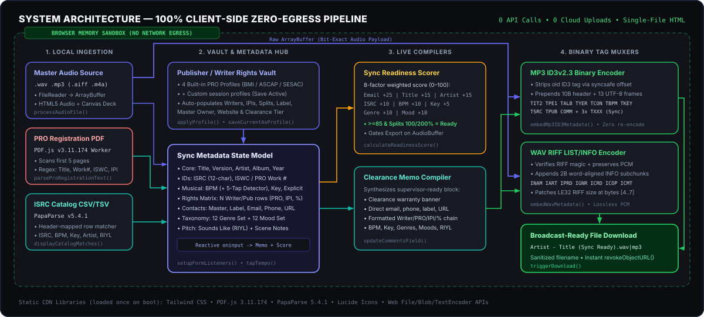
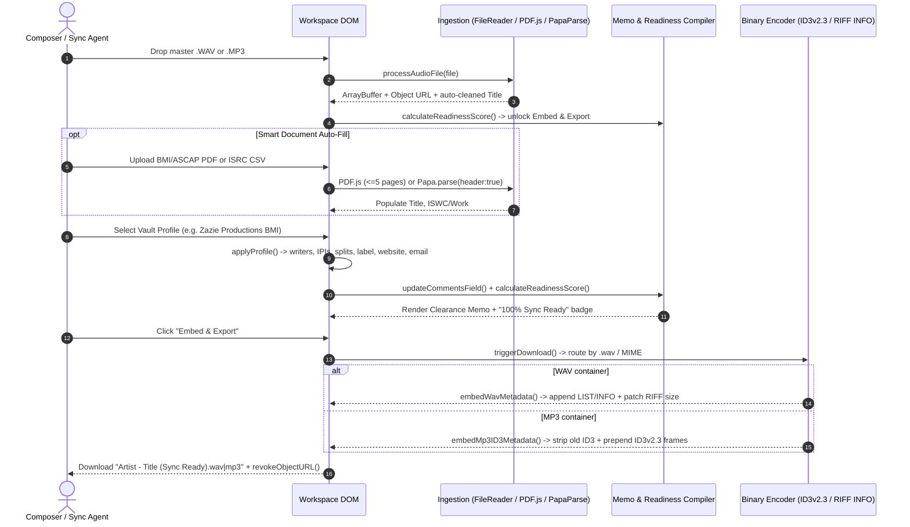
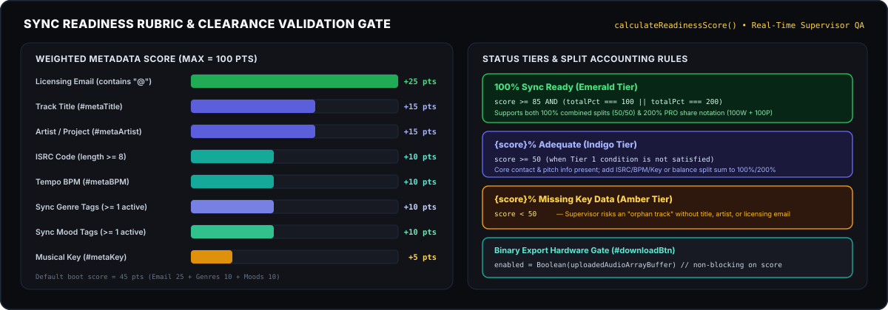

# System Architecture

> **Scope:** Runtime topology, subsystem responsibilities, state model, reactive compilation loop, and memory lifecycle of **SyncTag Pro** (`index.html`).



---

## 1. Architectural Philosophy

SyncTag Pro is engineered around a deliberately minimal **single-file, zero-backend architecture**:

| Principle | Architectural Choice | Practical Payoff |
|---|---|---|
| **Zero Data Egress** | All ingestion, parsing, validation, and binary muxing execute in-tab via Web APIs | Unreleased film scores, agency demos, and IPI/split filings never touch an external server |
| **Zero Build Step** | Single self-contained `index.html` (~88 KB) with browser-native ES2020+ and CDN helpers | Instant deployment to any static host, S3 bucket, GitHub Pages, or localhost port |
| **Lossless Audio Passthrough** | Byte-level `Uint8Array` container surgery instead of Web Audio re-encoding | 0% generation loss on 24-bit/48 kHz broadcast WAVs and 320 kbps MP3s; millisecond export |
| **Reactive Supervisor QA** | Every form mutation synchronously recomputes the Clearance Memo and Readiness Score | Eliminates "orphan tracks" missing direct licensing contacts or split percentages |

---

## 2. Subsystem Map

All seven runtime modules reside inside `index.html` and communicate through shared in-memory state and DOM bindings:

| # | Subsystem | Primary Functions | Inputs | Outputs |
|---|---|---|---|---|
| **1** | **Boot & UI Hydration** | `DOMContentLoaded`, `initGenreAndMoodClouds()`, `setupFormListeners()`, `showToast()`, `logStatus()` | Initial preset arrays & DOM nodes | Hydrated Lucide icons, active genre/mood clouds, event listeners, toast & terminal logs |
| **2** | **Audio Source Deck** | `setupDropzone()`, `processAudioFile()`, `loadAudioIntoPlayer()`, `drawDummyWaveform()` | Dropped/selected `File` (`.wav`, `.mp3`, `.aiff`, `.m4a`) | `uploadedAudioArrayBuffer`, `<audio>` Object URL playback, `<canvas>` progress waveform, cleaned title |
| **3** | **PDF Registration Parser** | `setupDocumentIngest()`, `handlePdfUpload()`, `parseProRegistrationText()` | BMI/ASCAP/PRO registration `.pdf` | Extracted Work Title, Work #, ISWC (`T-XXX.XXX.XXX-X`), and up to N deduplicated 9–11 digit IPI/CAE IDs |
| **4** | **CSV Catalog Matcher** | `handleCsvUpload()`, `displayCatalogMatches()` | `.csv`, `.tsv`, or `.txt` spreadsheet | `parsedSpreadsheetCatalog[]`, up to 10 interactive match cards populating Title, ISRC, BPM, Key, Artist, RIYL |
| **5** | **Rights Vault Manager** | `renderProfilePills()`, `applyProfile()`, `openProfileModal()`, `closeProfileModal()`, `applyProfileFromModal()`, `saveCurrentAsProfile()` | `syncProfiles[]` + active form fields | 1-click population of Artist, Master Owner, Label, Website, Email, Phone, Clearance, and dynamic Writer/PRO rows |
| **6** | **Live QA & Memo Compilers** | `updateCommentsField()`, `calculateReadinessScore()`, `addWriterRow()`, `removeWriterRow()`, `tapTempo()`, `toggleGenre()`, `toggleMood()` | All metadata controls, `.writer-row` nodes, taxonomy `Set`s | Formatted multi-line `#metaComments` memo, 0–100 `#syncScoreBadge` tier, `#downloadBtn` gate, computed BPM |
| **7** | **Binary Tag Muxers** | `triggerDownload()`, `stringToBytes()`, `embedMp3ID3Metadata()`, `embedWavMetadata()` | `uploadedAudioArrayBuffer` + assembled `meta` dictionary | Tagged `Blob` (`audio/mpeg` or `audio/wav`) downloaded as `Artist - Title (Sync Ready).{mp3,wav}` |

---

## 3. Runtime State Model

SyncTag Pro divides runtime state into two layers:

### 3.1 JavaScript Module-Scope State

| Binding | Type | Initial Value | Lifecycle |
|---|---|---|---|
| `uploadedAudioBlob` | `File \| null` | `null` | Replaced on each audio file drop/browse; feeds `<audio>` preview via `URL.createObjectURL()` |
| `uploadedAudioArrayBuffer` | `ArrayBuffer \| null` | `null` | Raw source bytes loaded via `FileReader.readAsArrayBuffer()`; enables `#downloadBtn`; read-only input to binary muxers |
| `audioFileName` | `string` | `"sync_track_master.mp3"` | Determines WAV vs. MP3 muxer branch (`.endsWith('.wav')`) and badge label |
| `audioFileType` | `string` | `"audio/mpeg"` | MIME type fallback (`audio/wav` vs. `audio/mpeg`) |
| `audioDurationSeconds` | `number` | `0` | Populated on `audioElement.onloadedmetadata`; normalizes waveform playhead ratio |
| `bpmTapTimes` | `number[]` | `[]` | Rolling sliding window of up to 5 `Date.now()` timestamps for inter-tap BPM averaging |
| `parsedSpreadsheetCatalog` | `object[]` | `[]` | Row objects produced by `Papa.parse(..., { header: true, skipEmptyLines: true })` |
| `syncProfiles` | `SyncProfile[]` | 4 built-in presets | Session-scoped Rights Vault array; extended in memory via `saveCurrentAsProfile()` |
| `selectedGenres` | `Set<string>` | `{"Cinematic Tension", "Trailer Hybrid Orchestral"}` | Active subset of the 12 `PRESET_GENRES`; joined by `' / '` in ID3 `TCON` and `', '` in memo |
| `selectedMoods` | `Set<string>` | `{"Building / Crescendo", "Suspenseful / Mysterious"}` | Active subset of the 12 `PRESET_MOODS`; joined by `', '` in ID3 `TXXX:MOOD` and memo |

### 3.2 DOM-Backed Form State

Scalar metadata fields (`#metaTitle`, `#metaVersion`, `#metaArtist`, `#metaAlbum`, `#metaYear`, `#metaISRC`, `#metaISWC`, `#metaClearance`, `#metaBPM`, `#metaKey`, `#metaExplicit`, `#metaMasterOwner`, `#metaContactEmail`, `#metaContactPhone`, `#metaRecordLabel`, `#metaWebsite`, `#metaSoundsLike`, `#metaPlacementNotes`, `#metaComments`) and repeatable `.writer-row` elements act as the single source of truth for editor values. No virtual DOM or external store synchronization is required.

---

## 4. End-to-End Execution Sequence



---

## 5. Sync Readiness Scoring Engine



`calculateReadinessScore()` computes an integer score `S ∈ [0, 100]` and split sum `P = Σ split_i`:

```text
S = 15·[title ≠ ""]
  + 15·[artist ≠ ""]
  + 25·["@" ∈ email]
  + 10·[len(isrc) ≥ 8]
  + 10·[bpm ≠ ""]
  +  5·[key ≠ ""]
  + 10·[|selectedGenres| > 0]
  + 10·[|selectedMoods| > 0]
```

Status classification follows a strict decision ladder:

1. **`100% Sync Ready`** (Emerald): `S ≥ 85` **and** `(P === 100 || P === 200)`
2. **`{S}% Adequate`** (Indigo): `S ≥ 50` (including `S ≥ 85` when `P ∉ {100, 200}`)
3. **`{S}% Missing Key Data`** (Amber): `S < 50`

The dual `100 || 200` check reflects real-world performing rights accounting: combined publishing/writer sheets sum to **100%** (e.g., `50%` writer + `50%` publisher), whereas BMI/ASCAP schedule exports frequently express independent Writer Share (**100%**) and Publisher Share (**100%**) totaling **200%**.

Importantly, the readiness score is **advisory, not punitive**: `#downloadBtn` unlocks as soon as `uploadedAudioArrayBuffer` is present so engineers can still export rough cues or work-in-progress demos.

---

## 6. External Dependencies

| Library | Version | Delivery URL | Role | Failure Mode if Offline |
|---|---|---|---|---|
| **Tailwind CSS** | Play CDN | `https://cdn.tailwindcss.com` | Utility class generation & dark theme tokens | Unstyled layout; functional HTML controls remain |
| **PDF.js** | `3.11.174` | `cdnjs.cloudflare.com/ajax/libs/pdf.js/3.11.174/pdf(.worker).min.js` | Extracts text from BMI/ASCAP PDF registrations | PDF upload fails; CSV, Vault, and binary export unaffected |
| **PapaParse** | `5.4.1` | `cdnjs.cloudflare.com/ajax/libs/PapaParse/5.4.1/papaparse.min.js` | Parses CSV/TSV ISRC catalog spreadsheets | CSV upload fails; PDF, Vault, and binary export unaffected |
| **Lucide** | `latest` | `https://unpkg.com/lucide@latest` | Renders `<i data-lucide="...">` SVG icons | Decorative icons absent; text labels remain functional |

The binary encoding engine itself (`stringToBytes`, `embedMp3ID3Metadata`, `embedWavMetadata`) relies on **zero external libraries** — only standard `Uint8Array`, `TextEncoder`, `Blob`, and `URL.createObjectURL`.

---

## 7. Known Architectural Trade-Offs & Evolution Path

| Area | Current v1.x Design | Planned Evolution |
|---|---|---|
| **WAV Broadcast Chunk** | Writes word-aligned RIFF `LIST`/`INFO` chunk (`INAM`..`ICMT`); preserves existing chunks | Add optional EBU Tech 3285 `bext` chunk (602-byte header + coding history) and replace-in-place existing `LIST`/`INFO` chunks |
| **ID3 Encoding Header** | Writes ID3v2.3 header (`0x03 0x00`) + BE32 frame sizes with UTF-8 encoding flag (`0x03`) | Offer strict ID3v2.4 (`0x04 0x00` + syncsafe frame sizes + `TDRC`) and strict ID3v2.3 (`0x01` UTF-16 BOM) selector |
| **AIFF / M4A Handling** | Accepted in file picker for preview; export currently routes non-WAV extensions through `embedMp3ID3Metadata()` | Add dedicated AIFF `ID3 ` IFF chunk muxer and MP4 `udta/meta/ilst` atom writer (or guard unsupported export formats) |
| **WAV Memory Copy** | Allocates `new Uint8Array(originalBytes.length + listChunk.length)` (~2× file size peak RAM) | Compose zero-copy `new Blob([patchedHeader, originalFile.slice(8), listChunk])` for multi-hundred-MB stem masters |
| **Vault Persistence** | In-memory `syncProfiles[]` (resets on tab reload) | Opt-in `localStorage` persistence with JSON Vault import/export |
| **Waveform Renderer** | Deterministic harmonic bar visualization tracking playback progress (`drawDummyWaveform`) | Optional `AudioContext.decodeAudioData()` peak-envelope cache with click-to-seek |
