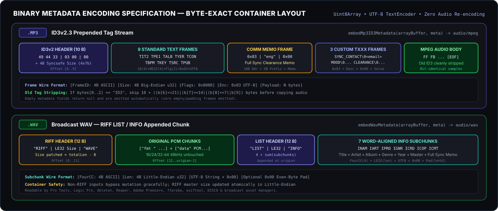

# Binary Metadata Format Specification

> **Scope:** Byte-exact container formats, bit-level integer encodings, frame/subchunk mappings, audio integrity guarantees, and interoperability notes for `embedMp3ID3Metadata()` and `embedWavMetadata()`.



---

## 1. Container Dispatch & Filename Sanitization

When `triggerDownload()` runs, SyncTag Pro classifies the loaded file by extension and MIME type:

```js
const isWav =
  audioFileName.toLowerCase().endsWith('.wav') ||
  audioFileType.includes('wav');
```

| Condition | Encoder Function | Output MIME | Output Extension |
|---|---|---|---|
| `isWav === true` | `embedWavMetadata(arrayBuffer, meta)` | `audio/wav` | `.wav` |
| `isWav === false` | `embedMp3ID3Metadata(arrayBuffer, meta)` | `audio/mpeg` | `.mp3` |

> **Format Advisory:** Although `#audioFileInput` permits `.aiff` and `.m4a` for browser auditioning, only `.wav` and `.mp3` have dedicated binary container encoders in v1.x. Always supply uncompressed `.wav` or `.mp3` masters when running **Embed & Export**.

Output filenames follow standard sync-delivery naming and strip Windows/macOS/POSIX reserved characters:

```text
Pattern:   {Artist} - {Title} (Sync Ready).{wav|mp3}
Sanitizer: .replace(/[/\\?%*:|"<>]/g, '_')
```

All string payloads are serialized using the WHATWG `TextEncoder` API (`UTF-8`, no BOM).

---

## 2. MP3 Container Specification (`embedMp3ID3Metadata`)

### 2.1 Pre-Existing ID3v2 Tag Stripping

Before prepending new metadata, SyncTag Pro checks bytes `[0..2]` of the source buffer for an existing `"ID3"` (`0x49 0x44 0x33`) header. If present, it decodes the 28-bit syncsafe tag length from bytes `[6..9]` and slices the raw MPEG audio stream starting immediately after the old tag:

```text
existingSize = (b[6] << 21) | (b[7] << 14) | (b[8] << 7) | b[9]
audioOffset  = 10 + existingSize
cleanAudio   = originalBytes.slice(audioOffset)
```

MPEG audio frames (`0xFF 0xFB ...`) are copied verbatim — zero decoding, zero re-quantization, zero bitrate alteration.

### 2.2 ID3v2 Header Layout (10 Bytes)

| Byte Offset | Width | Hex / Formula | Meaning |
|---|---|---|---|
| `0..2` | 3 B | `49 44 33` | File identifier `"ID3"` |
| `3` | 1 B | `03` | Major version: ID3v2.**3** |
| `4` | 1 B | `00` | Revision: `.0` |
| `5` | 1 B | `00` | Header flags (unsynchronisation=0, extended=0, experimental=0) |
| `6` | 1 B | `(S >> 21) & 0x7F` | Total frame payload size bits `27..21` (MSB always `0`) |
| `7` | 1 B | `(S >> 14) & 0x7F` | Total frame payload size bits `20..14` (MSB always `0`) |
| `8` | 1 B | `(S >> 7) & 0x7F` | Total frame payload size bits `13..7` (MSB always `0`) |
| `9` | 1 B | `S & 0x7F` | Total frame payload size bits `6..0` (MSB always `0`) |

Where `S = totalFramesSize` (sum of all non-null frame byte lengths, max `2^28 - 1 = 268,435,455` bytes ≈ 256 MiB).

### 2.3 Frame Wire Formats

Every frame starts with a 10-byte frame header followed by a type-specific payload. Frames whose source field is an empty string (`""`) return `null` and are omitted cleanly.

#### A. Standard Text Frame (`T***`)

```text
+----------+--------------+----------+---------+----------------------+
| Frame ID | Frame Size   | Flags    | Enc     | UTF-8 Text Bytes     |
| 4B ASCII | 4B BE uint32 | 0x00 00  | 0x03    | N bytes (no NUL)     |
+----------+--------------+----------+---------+----------------------+
  [0..3]     [4..7]         [8..9]     [10]      [11 .. 10+N]
             Size = 1 + N
```

#### B. Comment Frame (`COMM`)

```text
+--------+--------------+---------+------+-----------+-------+------------------+
| "COMM" | Frame Size   | Flags   | Enc  | Language  | Desc  | UTF-8 Memo Text  |
| 4B     | 4B BE uint32 | 0x00 00 | 0x03 | "eng"(3B) | 0x00  | N bytes          |
+--------+--------------+---------+------+-----------+-------+------------------+
  [0..3]   [4..7]         [8..9]    [10]   [11..13]    [14]    [15 .. 14+N]
           Size = 5 + N                    65 6E 67
```

#### C. User-Defined Text Frame (`TXXX`)

```text
+--------+--------------+---------+------+------------+------+------------------+
| "TXXX" | Frame Size   | Flags   | Enc  | UTF-8 Desc | NUL  | UTF-8 Value      |
| 4B     | 4B BE uint32 | 0x00 00 | 0x03 | D bytes    | 0x00 | V bytes          |
+--------+--------------+---------+------+------------+------+------------------+
  [0..3]   [4..7]         [8..9]    [10]   [11..10+D]   11+D   [12+D .. 11+D+V]
           Size = 2 + D + V
```

### 2.4 Complete Emitted ID3 Frame Table (13 Frames)

Frames are written sequentially in the exact order below:

| Order | Frame ID | Sub-Key | UI Source | Fallback if Empty | Sync Supervision Purpose |
|---|---|---|---|---|---|
| 1 | `TIT2` | — | `#metaTitle` | `'Sync Track'` | Cue / track title in DISCO, iTunes, Rekordbox, DAWs |
| 2 | `TPE1` | — | `#metaArtist` | `'Unknown Artist'` | Primary performing artist or composer entity |
| 3 | `TALB` | — | `#metaAlbum` | `'Sync Catalog'` | Album, sync reel, or pitching playlist name |
| 4 | `TYER` | — | `#metaYear` | `'2025'` | Recording / copyright release year |
| 5 | `TCON` | — | `selectedGenres` | `'Soundtrack'` | Active sync genres delimited by `' / '` |
| 6 | `TBPM` | — | `#metaBPM` | *(omitted)* | Integer tempo for editorial beat-matching |
| 7 | `TKEY` | — | `#metaKey` | *(omitted)* | Musical key / tonality (e.g., `D Minor`) |
| 8 | `TSRC` | — | `#metaISRC` | *(omitted)* | ISO 3901 International Standard Recording Code |
| 9 | `TPUB` | — | `#metaMasterOwner` | *(omitted)* | Master recording rights holder / label |
| 10 | `COMM` | `lang="eng"` | `#metaComments` | *(omitted)* | Complete Sync Clearance Memo (contact, splits, IPIs, RIYL) |
| 11 | `TXXX` | `SYNC_CONTACT` | `#metaContactEmail` | *(omitted)* | Machine-readable direct licensing email |
| 12 | `TXXX` | `MOOD` | `selectedMoods` | *(omitted)* | Active sync mood tags delimited by `', '` |
| 13 | `TXXX` | `CLEARANCE` | `#metaClearance` | *(always set)* | One-stop / pre-cleared legal warranty string |

> **Standards Interoperability Note:** `embedMp3ID3Metadata()` combines an ID3v2.3 major-version byte (`0x03`) and 32-bit big-endian frame sizes with encoding byte `0x03` (UTF-8, standardized in ID3v2.4). Modern tag readers (`ffmpeg`/`libavformat`, `mutagen`, `music-metadata`, `exiftool`, Apple Music, VLC, DISCO) decode UTF-8 `0x03` frames cleanly across both v2.3 and v2.4. Legacy hardware or strict Windows Explorer parsers expecting ISO-8859-1 (`0x00`) or UTF-16 with BOM (`0x01`) on v2.3 tags may misrender non-ASCII glyphs (such as the `⚡` emoji in the first `CLEARANCE` option). Keep critical title/artist/contact text in printable ASCII for maximum legacy compatibility.

---

## 3. WAV Container Specification (`embedWavMetadata`)

### 3.1 RIFF Header Validation

`embedWavMetadata()` inspects bytes `[0..3]` for ASCII `"RIFF"` (`52 49 46 46`). If the file is not a valid RIFF container (for example, RF64 or raw PCM), it returns the original buffer unmodified as `Blob([originalBytes], { type: 'audio/wav' })` rather than risking corruption.

### 3.2 INFO Subchunk Wire Format

Each metadata entry is serialized as a null-terminated UTF-8 RIFF `INFO` subchunk padded to a 16-bit (2-byte) word boundary per the Microsoft/IBM RIFF 1.0 specification:

```text
bytes     = UTF8(str + "\0")         // includes mandatory trailing 0x00
len       = bytes.length
pad       = len % 2                  // 1 byte of 0x00 if len is odd, else 0
totalSize = 8 + len + pad

+----------+--------------+---------------------+------------------+
| FourCC   | Data Length  | UTF-8 Text + 0x00   | Word Align Pad   |
| 4B ASCII | 4B LE uint32 | len bytes           | 0 or 1B (0x00)   |
+----------+--------------+---------------------+------------------+
  [0..3]     [4..7]         [8 .. 7+len]          [8+len] (if odd)
```

Note that per the RIFF specification, `Data Length` records `len` (excluding the alignment pad byte), while the enclosing `LIST` chunk size includes the pad byte.

### 3.3 Enclosing `LIST` / `INFO` Chunk & Header Patch

```text
subchunksSize = 4 + Σ subchunk.length      // 4 bytes for "INFO" type ID
listChunk     = "LIST" (4B) + LE32(subchunksSize) (4B) + "INFO" (4B) + subchunks...
newTotalLen   = originalBytes.length + listChunk.length
riffSize      = newTotalLen - 8            // written as LE32 into newWav[4..7]
```

### 3.4 Complete Emitted WAV Subchunk Table (7 Subchunks)

| Order | FourCC | Standard RIFF Name | UI Source | Fallback | Content |
|---|---|---|---|---|---|
| 1 | `INAM` | Name / Title | `#metaTitle` | `'Sync Track'` | Track / cue title |
| 2 | `IART` | Artist | `#metaArtist` | `'Unknown Artist'` | Performing artist / composer |
| 3 | `IPRD` | Product / Album | `#metaAlbum` | `'Sync Catalog'` | Album, sync reel, or cue package |
| 4 | `IGNR` | Genre | `selectedGenres` | `'Soundtrack'` | Active sync genres (`' / '` separated) |
| 5 | `ICRD` | Creation Date | `#metaYear` | `'2025'` | Release / production year |
| 6 | `ICOP` | Copyright | `#metaMasterOwner` | *(omitted)* | Master owner / copyright entity |
| 7 | `ICMT` | Comments | `#metaComments` | *(omitted)* | Full Broadcast Sync Clearance Memo (contains BPM, key, email, phone, label, URL, writers, PROs, IPIs, splits, moods, RIYL) |

### 3.5 WAV Implementation Boundaries

- **PCM Sample Preservation:** All original chunks (`fmt `, `data`, existing `bext`, `iXML`, `cue `, `smpl`) in `[12 .. originalBytes.length - 1]` remain byte-for-byte untouched.
- **32-Bit RIFF Ceiling:** Standard RIFF stores file size as an unsigned 32-bit little-endian integer (max **4 GiB**).
- **Repeated Tagging:** Appending a `LIST`/`INFO` chunk to an already-tagged WAV leaves any earlier `LIST`/`INFO` chunk in place (most readers prefer the final or first chunk depending on parser). Tag from your clean master bounce when re-exporting revisions.
- **Broadcast Wave `bext` Note:** While `ICMT` carries the full Broadcast Sync Clearance Memo, a dedicated 602-byte EBU Tech 3285 `bext` chunk (with SMPTE timecode `TimeReference` and `Originator`) is tracked on the v1.2 roadmap.

---

## 4. Inspecting Exported Files from the CLI

```bash
# Inspect all ID3v2.3 or RIFF INFO tags via FFmpeg
ffprobe -hide_banner "Zazie Productions - Quantum Horizon (Trailer Mix) (Sync Ready).mp3"
ffprobe -hide_banner "Zazie Productions - Quantum Horizon (Trailer Mix) (Sync Ready).wav"

# Dump complete tag dictionary including custom TXXX frames via ExifTool
exiftool -G1 -a -s "Zazie Productions - Quantum Horizon (Trailer Mix) (Sync Ready).mp3"

# Verify RIFF chunk tree of an exported WAV with Python 3 (stdlib only)
python3 -c '
import struct, sys
data = open(sys.argv[1], "rb").read()
assert data[:4] == b"RIFF" and data[8:12] == b"WAVE"
riff_size = struct.unpack_from("<I", data, 4)[0]
print(f"RIFF size={riff_size} (file={len(data)}, valid={riff_size == len(data) - 8})")
pos = 12
while pos + 8 <= len(data):
    cid = data[pos:pos+4].decode("ascii", "replace")
    csz = struct.unpack_from("<I", data, pos+4)[0]
    print(f"  Chunk {cid!r} @ {pos}: {csz} bytes")
    if cid == "LIST" and data[pos+8:pos+12] == b"INFO":
        sub = pos + 12
        end = pos + 8 + csz
        while sub + 8 <= end:
            sid = data[sub:sub+4].decode("ascii", "replace")
            ssz = struct.unpack_from("<I", data, sub+4)[0]
            val = data[sub+8:sub+8+ssz].rstrip(b"\x00").decode("utf-8", "replace")
            print(f"    {sid}: {val.splitlines()[0]!r}")
            sub += 8 + ssz + (ssz % 2)
    pos += 8 + csz + (csz % 2)
' "Zazie Productions - Quantum Horizon (Trailer Mix) (Sync Ready).wav"
```
